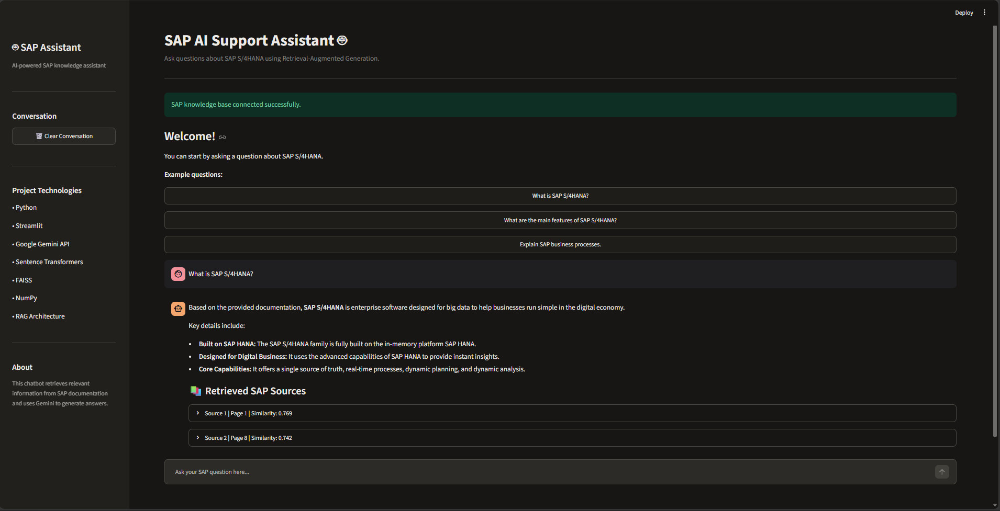

# AI-Powered SAP Support Chatbot

An intelligent SAP documentation assistant built using **Retrieval-Augmented Generation (RAG)**, FAISS, Sentence Transformers, Google Gemini API and Streamlit.

The application allows users to ask questions about SAP S/4HANA and receive AI-generated answers based on relevant information retrieved from SAP documentation.

## Project Overview

Traditional document searching requires users to manually search through lengthy technical documentation.

This project addresses that problem by combining semantic search with a Large Language Model (LLM).

The chatbot retrieves relevant information from SAP documentation using vector similarity search and passes that information to Google Gemini to generate contextual answers.

## Application Preview



## Key Features

- **Document Processing:** Extracts text from SAP PDF documentation.
- **Text Chunking:** Divides extracted documents into smaller, overlapping text chunks.
- **Semantic Search:** Uses Sentence Transformers to convert text into numerical embeddings.
- **Vector Database:** Stores and searches document embeddings using FAISS.
- **Persistent Storage:** Saves the FAISS index and document metadata for reuse.
- **RAG Architecture:** Combines document retrieval with LLM-based answer generation.
- **Gemini Integration:** Uses Google Gemini API to generate responses.
- **Prompt Engineering:** Uses structured prompts to encourage grounded answers and reduce hallucinations.
- **Streamlit Interface:** Provides an interactive chatbot interface.
- **Source References:** Displays retrieved document sources and page information.

## Technology Stack

| Category | Technologies |
|---|---|
| Programming Language | Python |
| Frontend | Streamlit |
| LLM | Google Gemini |
| LLM Integration | Google Gen AI SDK |
| AI Architecture | Retrieval-Augmented Generation |
| Embedding Model | all-MiniLM-L6-v2 |
| Vector Database | FAISS |
| NLP | Sentence Transformers |
| Numerical Processing | NumPy |
| Configuration | python-dotenv |
| Version Control | Git and GitHub |

## System Architecture


## System Architecture

The chatbot follows a Retrieval-Augmented Generation (RAG) architecture.

The system processes SAP documentation, generates embeddings, retrieves relevant information using FAISS, and generates contextual responses using Google Gemini.

For a detailed architecture diagram, see [ARCHITECTURE.md](ARCHITECTURE.md).


## How RAG Works in This Project

**1. Document Loading**

The SAP PDF document is loaded and its text is extracted using Python.

**2. Text Chunking**

The extracted text is divided into smaller chunks.

Current configuration:
- Chunk size: 150 words
- Chunk overlap: 30 words

Metadata such as source, page number and chunk ID is preserved.

**3. Embedding Generation**

The Sentence Transformers model `all-MiniLM-L6-v2` converts text chunks into numerical vectors.

**4. Vector Database**

FAISS stores the generated embeddings and performs similarity searches.

The project uses `IndexFlatIP` with normalized embeddings to perform inner-product similarity search.

**5. Context Retrieval**

When a user asks a question, the query is converted into an embedding and compared with stored document vectors.

Relevant chunks are selected using a configurable similarity threshold.

**6. Prompt Construction**

The retrieved document chunks and user question are combined into a structured prompt.

**7. Answer Generation**

Google Gemini receives the prompt and generates a contextual response.

**8. Source Display**

The Streamlit application displays the generated response and retrieved document references.

## Project Structure

```text
SAP_Support_Chatbot/
│
├── data/
│   ├── raw/
│   │   └── sap_s4hana_2025.pdf
│   │
│   └── processed/
│       ├── faiss_index.bin
│       ├── chunks.json
│       └── sap_extracted.txt
│
├── src/
│   ├── document_loader.py
│   ├── text_chunker.py
│   ├── embeddings.py
│   ├── vector_store.py
│   ├── retriever.py
│   ├── test_retrieval.py
│   ├── evaluate_retrieval.py
│   ├── llm.py
│   ├── prompt_builder.py
│   └── rag_pipeline.py
│
├── app.py
├── README.md
├── requirements.txt
├── .env.example
└── .gitignore
```

## Installation and Setup

### Prerequisites

- Python installed on your system.
- Git installed.
- Google Gemini API key.
- VS Code or another Python editor.

### 1. Clone the repository

```bash
git clone https://github.com/ayush-kadlag/AI-Powered-SAP-Support-Chatbot.git
```

### 2. Navigate to the project directory

```bash
cd AI-Powered-SAP-Support-Chatbot
```

### 3. Create a virtual environment

```bash
python -m venv venv
```

### 4. Activate the virtual environment

Windows PowerShell:

```powershell
.\venv\Scripts\Activate.ps1
```

### 5. Install dependencies

```bash
pip install -r requirements.txt
```

### 6. Configure Gemini API

Create a `.env` file in the project root directory.

Add:

```env
GEMINI_API_KEY=your_actual_api_key
```

Replace the placeholder with your own Gemini API key.

Never upload your actual `.env` file to GitHub.

### 7. Run the application

```bash
streamlit run app.py
```

Open the application in your browser:

```text
http://localhost:8501
```

## Example Usage

Example questions:

1. What is SAP S/4HANA?
2. What are the main features of SAP S/4HANA?
3. Explain SAP business processes.
4. What is SAP FI?

The chatbot retrieves relevant SAP documentation and uses Gemini to generate an answer.

## Important Implementation Details

| Component | Implementation |
|---|---|
| Embedding Model | all-MiniLM-L6-v2 |
| Chunk Size | 150 words |
| Chunk Overlap | 30 words |
| Vector Index | FAISS IndexFlatIP |
| Similarity Threshold | 0.60 |
| LLM | Google Gemini |
| Interface | Streamlit |

## Future Improvements

- Improve retrieval accuracy and relevance.
- Evaluate similarity threshold performance.
- Improve answer grounding and hallucination detection.
- Enhance source attribution.
- Add conversation management.
- Improve response handling and error reporting.
- Add more SAP documentation and knowledge sources.
- Explore deployment options.

## Security

- API keys are stored in environment variables.
- `.env` is excluded through `.gitignore`.
- Python virtual environment files are excluded from version control.
- Never commit API keys, passwords or private credentials.

## Author

**Ayush Kadlag**

GitHub: [ayush-kadlag](https://github.com/ayush-kadlag)

Project Repository: [AI-Powered-SAP-Support-Chatbot](https://github.com/ayush-kadlag/AI-Powered-SAP-Support-Chatbot)

---

*Developed as an AI/ML project to explore document processing, semantic search, vector databases, Retrieval-Augmented Generation and Large Language Model integration.*